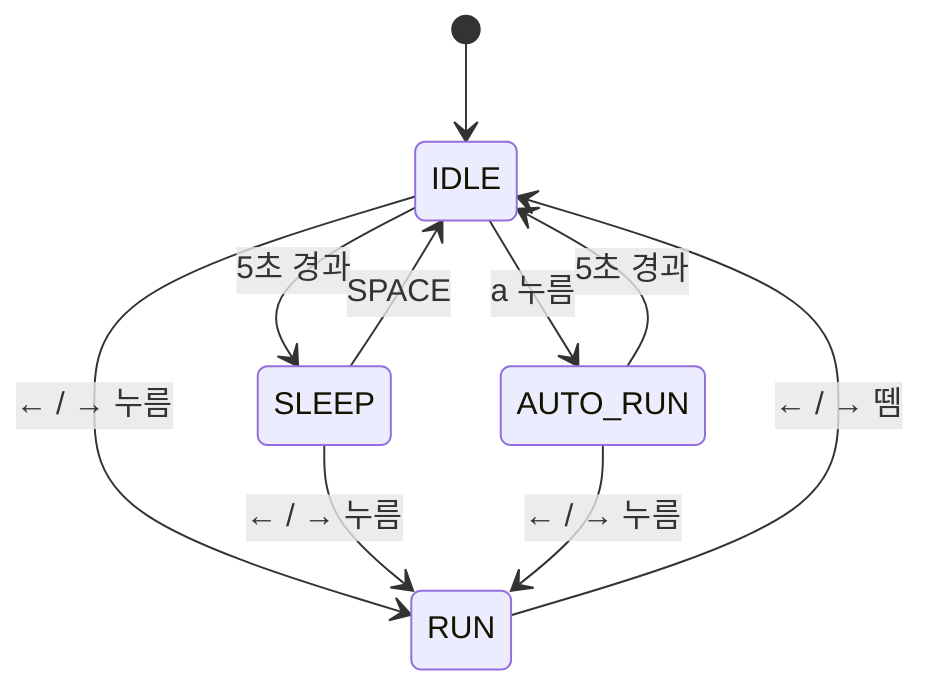

# PRD — Drill #11. 소년 자동 무적 런(AutoRun) 상태 추가

## 1. 개요

기존 소년(Boy) 캐릭터의 상태 머신(IDLE / SLEEP / RUN)에 **AUTO_RUN** 상태를 추가한다.
IDLE 상태에서 `a` 키를 누르면 소년이 키 조작 없이 좌우로 자동 이동하며, 일정 시간이 지나거나 방향키를 누르면 원래 상태로 돌아간다.

- 언어/라이브러리: Python, `pico2d`, `transitions`
- 대상 파일: `boy.py` (주 수정), `main.py` (변경 없음 예상)
- 제출물: 소스 코드 + 상태 다이어그램 이미지 파일 (저장소에 포함)

## 2. 현재 구조 (AS-IS)

| 항목 | 내용 |
| --- | --- |
| 상태 | `IDLE`, `SLEEP`, `RUN` (문자열 상태, `transitions.Machine` 사용) |
| 전이 | `time_out`: IDLE → SLEEP / `space_down`: SLEEP → IDLE / `run`: IDLE·SLEEP → RUN / `stop`: RUN → IDLE |
| 이동 | RUN 상태에서 `dir * 5` 픽셀/프레임, x는 `25 ~ 775`로 clamp |
| 그리기 | `update()` / `draw()` 안에서 `if self.state == ...` 분기로 처리 |

상태별 동작이 `Boy`의 `update()` / `draw()`에 `if` 분기로 섞여 있어, 과제 요구사항인 **"AutoRun 상태 클래스"** 를 추가하려면 먼저 상태를 클래스로 분리하는 리팩터링이 필요하다.

## 3. 요구사항

### 3.1 기능 요구사항

| ID | 요구사항 |
| --- | --- |
| F1 | IDLE 상태에서 `a` 키를 누르면 AUTO_RUN 상태로 전환된다. |
| F2 | AUTO_RUN 상태에서는 키 조작 없이 바라보는 방향으로 계속 이동한다. |
| F3 | AUTO_RUN 상태에서는 이동 속도가 RUN보다 빠르다. (RUN 5 → AUTO_RUN 15 픽셀/프레임) |
| F4 | AUTO_RUN 상태에서는 소년의 크기가 **2배**로 커진다. (100×100 → 200×200, 발이 땅에 닿도록 y 보정) |
| F5 | 화면 좌우 끝에 닿으면 자동으로 방향을 반대로 바꾼다. (커진 크기 기준으로 경계 계산) |
| F6 | AUTO_RUN 진입 후 5초 이상 지나면 IDLE 상태로 돌아간다. |
| F7 | AUTO_RUN 상태에서 방향키(←/→)를 누르면 무적 런이 취소되고, 눌린 방향으로 움직이는 RUN 상태로 전환된다. |

### 3.2 구현 제약

| ID | 제약 |
| --- | --- |
| C1 | **반드시 `AutoRun` 상태 클래스를 추가해서 구현**한다. |
| C2 | 기존 상태(`Idle`, `Sleep`, `Run`)도 같은 형태의 클래스로 맞춘다. 각 상태 클래스는 `enter / exit / do / draw` 를 가진다. |
| C3 | 전이 규칙은 기존처럼 `transitions.Machine`의 전이 테이블로 관리하고, 상태 진입/이탈 시 해당 상태 객체의 `enter / exit` 을 호출한다. |
| C4 | 상태 다이어그램 이미지를 그려 저장소에 포함한다. (`state_diagram.png`) |

### 3.3 범위 밖

- SLEEP 상태에서 `a` 키 입력 (요구사항은 IDLE에서만 진입)
- 충돌, 무적 판정 등 "무적"의 실제 게임 로직 (이번 과제는 이동/크기/전이만 다룸)

## 4. 상태 설계

### 4.1 전이 표

| 현재 상태 | 이벤트 | 다음 상태 |
| --- | --- | --- |
| IDLE | 5초 경과 (`time_out`) | SLEEP |
| IDLE | ←/→ 누름 (`run`) | RUN |
| IDLE | `a` 누름 (`a_down`) | **AUTO_RUN** |
| SLEEP | SPACE 누름 (`space_down`) | IDLE |
| SLEEP | ←/→ 누름 (`run`) | RUN |
| RUN | ←/→ 모두 뗌 (`stop`) | IDLE |
| **AUTO_RUN** | 5초 경과 (`time_out`) | IDLE |
| **AUTO_RUN** | ←/→ 누름 (`run`) | RUN |

### 4.2 상태 다이어그램 (초안)



> 제출용 이미지는 위 다이어그램을 기준으로 `state_diagram.png` 로 저장한다.

### 4.3 AutoRun 상태 클래스 동작

| 메서드 | 동작 |
| --- | --- |
| `enter` | 시작 시각 기록, 이동 방향을 현재 `face_dir` 로 설정 |
| `exit` | (특별한 처리 없음) |
| `do` | 프레임 갱신, `x += dir * 15`, 좌우 경계(`50 ~ 750`)에 닿으면 `dir`·`face_dir` 반전, 5초 경과 시 `time_out` |
| `draw` | RUN 스프라이트를 200×200 크기로 그림 (`clip_draw`의 출력 크기 지정), y를 50 올려 발 위치 유지 |

### 4.4 파일 구조

상태 클래스는 **별도 파일로 나누지 않고 `boy.py` 안에 `Boy` 클래스 위쪽에 함께 둔다.**

```
DRILL11/
├── main.py      # 게임 루프 (변경 없음)
├── grass.py     # Grass
└── boy.py       # Idle, Sleep, Run, AutoRun (상태 클래스) + Boy
```

- 기존의 "클래스마다 py 파일" 규칙은 **게임 오브젝트(Boy, Grass) 단위**의 분리다. 상태 클래스는 독립된 게임 오브젝트가 아니라 `Boy` 의 일부라서 `boy.py` 에 함께 두는 것이 자연스럽다.
- 상태 클래스 4개는 각각 수십 줄 수준이고 `Boy` 의 속성(`x`, `frame`, `image`, `face_dir` …)을 직접 다룬다. 파일을 나누면 서로 import 해야 해서 오히려 복잡해진다.
- 각 상태 객체는 생성 시 `boy` 를 받아 `self.boy` 로 참조한다.

```python
class Idle:
    def __init__(self, boy):
        self.boy = boy
    def enter(self): ...
    def exit(self): ...
    def do(self): ...
    def draw(self): ...
```

- `Boy` 는 상태 이름 → 상태 객체 딕셔너리를 가지고, `update()` / `draw()` 에서 현재 상태 객체의 `do()` / `draw()` 만 호출한다.
- 나중에 상태가 많아져 `boy.py` 가 커지면 그때 `boy_states.py` 하나로 모아서 분리한다. (상태별 파일 분리는 하지 않음)

## 5. 채점 기준 (체크리스트)

| # | 항목 | 확인 방법 |
| --- | --- | --- |
| 1 | `a` 를 누르면 AUTO_RUN 상태로 이동 | IDLE에서 `a` 입력 → 자동 이동 시작 |
| 2 | 5초 이상 경과하면 IDLE 상태로 복귀 | AUTO_RUN 진입 후 5초 대기 → 정지 |
| 3 | AUTO_RUN 모드에서 소년 속도가 빨라짐 | RUN보다 눈에 띄게 빠르게 이동 |
| 4 | **AUTO_RUN 모드에서 소년 크기가 2배로 커짐** | 200×200으로 그려지고, 발이 땅에 닿아 있음 |
| 5 | AUTO_RUN 모드에서 좌우 끝에서 자동 방향 전환 | 끝에 닿으면 반대 방향으로 이동, 바라보는 방향도 바뀜 |
| 6 | 상태 다이어그램 | 저장소에 `state_diagram.png` 포함 |
| (추가) | 방향키 입력 시 RUN으로 전환 | AUTO_RUN 중 ←/→ → 해당 방향 RUN, 크기 원래대로 |

## 6. 개발 진행 계획 (점진적 개발 + 커밋)

**원칙**

- 커밋은 **최소 30개 이상**. 함수 하나 옮기기, 상수 하나 추가하기 같은 작은 단위도 각각 커밋한다.
- 커밋 하나에는 **한 가지 변경만** 담는다. (예: "속도 변경"과 "크기 변경"은 따로)
- 커밋할 때마다 **실행해서 동작을 확인**한다. 어느 커밋으로 돌아가도 게임이 실행되어야 한다.
- 리팩터링 커밋(`refactor:`)은 동작을 바꾸지 않는다. 기능 커밋(`feat:`)과 섞지 않는다.
- 커밋 메시지 형식: `타입: 내용` (`docs` / `refactor` / `feat` / `fix` / `chore`)
- 진행 중 버그를 발견하면 `fix:` 커밋을 따로 추가한다. (아래 표의 번호는 계획이며, 중간에 커밋이 늘어날 수 있다)

### Phase A. 문서 (2)

| # | 작업 | 확인 | 커밋 메시지 |
| --- | --- | --- | --- |
| 1 | PRD 초안 작성 | 문서 검토 | `docs: Drill11 PRD 초안 작성` |
| 2 | 파일 구조·세분화된 커밋 계획 반영 | 문서 검토 | `docs: PRD에 상태 클래스 구조와 커밋 계획 추가` |

### Phase B. 기존 상태를 상태 클래스로 리팩터링 (14) — 동작 변화 없음

| # | 작업 | 확인 | 커밋 메시지 |
| --- | --- | --- | --- |
| 3 | `Idle` 클래스 뼈대 추가 (`__init__(boy)`, 빈 `enter/exit/do/draw`) | 기존과 동일하게 실행 | `refactor: Idle 상태 클래스 뼈대 추가` |
| 4 | `Boy.__init__` 에서 `Idle` 객체 생성 | 기존과 동일 | `refactor: Boy에서 Idle 상태 객체 생성` |
| 5 | IDLE 그리기 코드를 `Idle.draw` 로 이동, `Boy.draw` 에서 호출 | 서 있는 모습 동일 | `refactor: IDLE 그리기를 Idle.draw로 이동` |
| 6 | IDLE 5초 타임아웃 검사를 `Idle.do` 로 이동 | 5초 후 잠듦 | `refactor: IDLE 타임아웃 검사를 Idle.do로 이동` |
| 7 | `on_enter_IDLE` 의 시작 시각 기록을 `Idle.enter` 로 이동 | 5초 후 잠듦 | `refactor: IDLE 진입 처리를 Idle.enter로 이동` |
| 8 | `Sleep` 클래스 뼈대 추가 및 객체 생성 | 기존과 동일 | `refactor: Sleep 상태 클래스 뼈대 추가` |
| 9 | SLEEP 그리기 코드를 `Sleep.draw` 로 이동 | 누운 모습 동일 | `refactor: SLEEP 그리기를 Sleep.draw로 이동` |
| 10 | `Run` 클래스 뼈대 추가 및 객체 생성 | 기존과 동일 | `refactor: Run 상태 클래스 뼈대 추가` |
| 11 | RUN 이동 코드를 `Run.do` 로 이동 | 좌우 이동 동일 | `refactor: RUN 이동을 Run.do로 이동` |
| 12 | RUN 그리기 코드를 `Run.draw` 로 이동 | 달리는 모습 동일 | `refactor: RUN 그리기를 Run.draw로 이동` |
| 13 | 프레임 갱신을 각 상태의 `do` 로 이동 | 애니메이션 동일 | `refactor: 프레임 갱신을 각 상태 do로 이동` |
| 14 | 상태 이름 → 상태 객체 딕셔너리 추가 | 기존과 동일 | `refactor: 상태 이름과 상태 객체 매핑 추가` |
| 15 | `Boy.update` / `Boy.draw` 의 if 분기를 딕셔너리 호출로 교체 | 모든 상태 동작 동일 | `refactor: Boy update/draw를 현재 상태 객체에 위임` |
| 16 | `Machine` 의 상태 진입/이탈 콜백에서 상태 객체 `enter/exit` 호출 | 모든 전이 동작 동일 | `refactor: 상태 전이 시 enter/exit 자동 호출` |

### Phase C. AutoRun 상태 추가 (8) — `a` 키로 진입해 자동 이동

| # | 작업 | 확인 | 커밋 메시지 |
| --- | --- | --- | --- |
| 17 | `states` 목록에 `AUTO_RUN` 추가 | 기존과 동일 | `feat: AUTO_RUN 상태 이름 추가` |
| 18 | `AutoRun` 클래스 뼈대 추가 및 객체·딕셔너리 등록 | 기존과 동일 | `feat: AutoRun 상태 클래스 뼈대 추가` |
| 19 | `a_down` 전이 등록 (IDLE → AUTO_RUN) | 아직 키 처리 없음 | `feat: IDLE에서 AUTO_RUN으로 가는 a_down 전이 추가` |
| 20 | `handle_event` 에서 `a` 키 입력 시 `a_down()` 호출 (`SDLK_a` import) | `a` 누르면 상태 전환 (출력 확인) | `feat: a 키 입력 처리 추가` |
| 21 | `AutoRun.draw` — RUN 스프라이트로 그리기 (기본 크기) | `a` 누르면 달리는 모습 | `feat: AutoRun 그리기 구현` |
| 22 | `AutoRun.enter` — 이동 방향을 `face_dir` 로 설정 | 바라보는 방향으로 시작 | `feat: AutoRun 진입 시 이동 방향 설정` |
| 23 | `AutoRun.do` — 프레임 갱신 | 제자리 달리기 애니메이션 | `feat: AutoRun 애니메이션 프레임 갱신` |
| 24 | `AutoRun.do` — 키 입력 없이 `dir * 5` 로 이동 | 계속 이동 | `feat: AutoRun 자동 이동 구현` |

### Phase D. 좌우 끝 자동 방향 전환 (3)

| # | 작업 | 확인 | 커밋 메시지 |
| --- | --- | --- | --- |
| 25 | 오른쪽 끝에 닿으면 왼쪽으로 방향 전환 | 오른쪽 끝에서 되돌아옴 | `feat: AutoRun 오른쪽 끝에서 방향 전환` |
| 26 | 왼쪽 끝에 닿으면 오른쪽으로 방향 전환 | 왼쪽 끝에서 되돌아옴 | `feat: AutoRun 왼쪽 끝에서 방향 전환` |
| 27 | 방향 전환 시 `face_dir` 도 함께 변경 | 바라보는 방향이 같이 바뀜 | `feat: AutoRun 방향 전환 시 바라보는 방향 갱신` |

### Phase E. 속도 증가 (2)

| # | 작업 | 확인 | 커밋 메시지 |
| --- | --- | --- | --- |
| 28 | 속도 상수 `RUN_SPEED = 5`, `AUTO_RUN_SPEED` 분리 (값은 아직 5) | 속도 동일 | `refactor: 이동 속도를 상수로 분리` |
| 29 | `AUTO_RUN_SPEED = 15` | RUN보다 빠름 | `feat: AutoRun 이동 속도 3배 증가` |

### Phase F. 크기 2배 (4)

| # | 작업 | 확인 | 커밋 메시지 |
| --- | --- | --- | --- |
| 30 | 크기 배율 상수 `AUTO_RUN_SCALE = 2` 추가 | 기존과 동일 | `refactor: AutoRun 크기 배율 상수 추가` |
| 31 | `AutoRun.draw` 에서 200×200 크기로 그리기 | 2배 크기 (땅에 파묻힘) | `feat: AutoRun 상태에서 소년 크기 2배로 그리기` |
| 32 | y 좌표 보정 (+50) | 발이 땅에 닿음 | `fix: AutoRun 확대 시 발 위치 보정` |
| 33 | 방향 전환 경계를 커진 크기 기준(`50 ~ 750`)으로 조정 | 끝에서 몸이 잘리지 않음 | `fix: AutoRun 경계값을 확대된 크기에 맞게 조정` |

### Phase G. 5초 경과 시 IDLE 복귀 (3)

| # | 작업 | 확인 | 커밋 메시지 |
| --- | --- | --- | --- |
| 34 | `time_out` 전이에 AUTO_RUN → IDLE 추가 | 아직 동작 없음 | `feat: AUTO_RUN에서 IDLE로 가는 time_out 전이 추가` |
| 35 | `AutoRun.enter` 에서 시작 시각 기록 | 기존과 동일 | `feat: AutoRun 시작 시각 기록` |
| 36 | `AutoRun.do` 에서 5초 경과 시 `time_out()` 호출 | 5초 후 정지, 원래 크기 | `feat: AutoRun 5초 경과 시 IDLE 복귀` |

### Phase H. 방향키 입력 시 RUN 전환 (2)

| # | 작업 | 확인 | 커밋 메시지 |
| --- | --- | --- | --- |
| 37 | `run` 전이의 source 에 AUTO_RUN 추가 | AUTO_RUN 중 ←/→ → 해당 방향 RUN | `feat: AutoRun 중 방향키 입력 시 RUN 전환` |
| 38 | 전환 후 키를 떼면 IDLE 로 가는지 확인, 문제 있으면 수정 | RUN → 키 뗌 → IDLE | `fix: AutoRun에서 RUN 전환 후 방향 처리 수정` (필요 시) |

### Phase I. 제출 정리 (3)

| # | 작업 | 확인 | 커밋 메시지 |
| --- | --- | --- | --- |
| 39 | 상태 다이어그램 이미지 추가 | `state_diagram.png` 확인 | `docs: 상태 다이어그램 이미지 추가` |
| 40 | 채점 기준 체크리스트 점검 결과를 PRD 에 기록 | 5장 항목 모두 통과 | `docs: 채점 기준 점검 결과 기록` |
| 41 | 사용하지 않는 import·코드 정리 | 전체 동작 확인 | `chore: 불필요한 코드 정리` |

**합계: 계획 41개** (필요 시 `fix:` 커밋 추가)

## 7. 완료 조건

- 5장 채점 기준 체크리스트의 모든 항목이 실제 실행에서 확인된다.
- `AutoRun` 클래스가 `boy.py` 에 존재하고, AUTO_RUN 상태의 동작이 그 클래스 안에 구현되어 있다.
- `state_diagram.png` 가 저장소에 포함되어 있다.
- 6장의 계획대로 작은 단위의 커밋 기록이 **30개 이상** 남아 있다.

## 8. 진행 결과

### 8.1 구현 결과

| # | 채점 항목 | 구현 위치 | 구현 |
| --- | --- | --- | --- |
| 1 | `a` 를 누르면 AUTO_RUN 상태로 이동 | `Boy.handle_event` → `a_down` 전이 (IDLE → AUTO_RUN) | ✅ |
| 2 | 5초 이상 경과하면 IDLE 상태로 복귀 | `AutoRun.enter` 시작 시각 기록, `AutoRun.do` 에서 `time_out` (AUTO_RUN → IDLE) | ✅ |
| 3 | AUTO_RUN 모드에서 속도 증가 | `AUTO_RUN_SPEED = 15` (RUN 5의 3배) | ✅ |
| 4 | AUTO_RUN 모드에서 크기 2배 | `AUTO_RUN_SCALE = 2`, `AutoRun.draw` 에서 200×200, y +50 보정 | ✅ |
| 5 | 좌우 끝에서 자동 방향 전환 | `AutoRun.do` — 경계 `50 ~ 750` 에서 `dir`·`face_dir` 반전 | ✅ |
| 6 | 상태 다이어그램 | `state_diagram.png` | ✅ |
| (추가) | 방향키 입력 시 RUN 전환 | `run` 전이 source 에 AUTO_RUN 추가 | ✅ |

> 최종 실행 확인(`python main.py`)은 사용자가 직접 진행한다.

### 8.2 계획과 달라진 점

| 계획 | 실제 | 이유 |
| --- | --- | --- |
| 17 `states` 에 AUTO_RUN 추가 → 18 AutoRun 뼈대 | 17 AutoRun 뼈대 → 18 AUTO_RUN 상태 등록 | Phase B 이후 `states` 의 각 이름에 상태 객체가 있어야 해서 클래스를 먼저 만듦 |
| 38 RUN 전환 후 방향 처리 수정 (필요 시) | 생략 | `handle_event` 가 `dir`·`face_dir` 을 정한 뒤 `run()` 을 호출하므로 수정할 문제가 없었음 |
| 41 불필요한 import·코드 정리 | `refactor: 화면 너비를 상수로 정리` | 사용하지 않는 import 는 없었고, 반복되는 `800` 을 `SCREEN_WIDTH` 로 정리 |
| (계획 외) | `chore: __pycache__ 무시하도록 .gitignore 추가` | 첫 리팩터링 커밋에 `.pyc` 가 섞여 들어가 추가 |

### 8.3 커밋 수

- 개발 커밋(PRD 초안부터 이 기록까지): **41개** (저장소 전체 43개, 기존 2개 포함)
